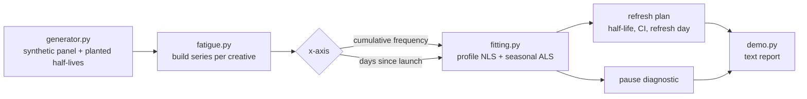

# fatigue

Creative-fatigue analysis that models ad response against cumulative per-user frequency instead of calendar time, so seasonality stops masquerading as burnout.

[](https://github.com/SlateGitOrg/fatigue/actions/workflows/ci.yml)

## Why

Creative performance decays with repeated exposure, but teams usually refresh creative on a fixed calendar, for example every six weeks. Some creatives are burned out in nine days and others are still performing at week twelve, so a calendar rule wastes money in both directions at once.

Calendar time is also a poor x-axis for fatigue. A creative shown twelve times in a week and one shown twelve times over two months sit at the same point on the fatigue curve. A calendar-time model mixes fatigue with every seasonal effect and delivery change in the period and cannot separate them. This project fits decay against cumulative frequency, removes a shared seasonal curve, and produces a per-creative refresh date.

## Features

- Per-creative fatigue fit, `response = a * 2^(-frequency / half-life)`, using a hand-written weighted nonlinear least-squares routine (no scipy).
- Shared seasonal curve estimated by alternating least squares, so calendar effects are separated from exposure effects.
- The same estimator run on a calendar-time axis, for a direct side-by-side comparison on identical data.
- Refresh plan per creative: the day response falls to a chosen fraction of its launch level, compared against a uniform 42-day policy.
- Pause diagnostic that shows how each model reads a stretch of dark days.
- Creatives with too little data return "insufficient data" instead of an unstable refresh date.
- Synthetic generator with planted true half-lives, so recovery can be tested against known truth.

## Architecture



`generator.py` produces a daily panel in which the true response depends only on impressions per reachable user, while calendar time is polluted by a seasonal cycle and by flighted or paused delivery. `fatigue.py` builds one series per creative on either axis and runs both through the same estimator in `fitting.py`, so the only difference between the two models is the x-axis. `demo.py` prints the comparison, the refresh plan and the pause test.

## Quick start

Requires Python 3.11+. The code uses only the standard library, so there is nothing to install.

```bash
git clone https://github.com/SlateGitOrg/fatigue.git
cd fatigue
python -m unittest discover -s tests -v   # 31 tests, a few seconds
python -m src.demo                        # the full comparison report
```

## Example

`python -m src.demo` (seed 20260912, 8 creatives, 664 creative-days, 110-day season at +/-30%), trimmed:

```text
creative            true HL    freq HL      freq 95% CI       cal HL
                 (exposures) (exposures)      (exposures)       (days)
C1_base_rate           6.00       5.98     [5.86, 6.10]         63.5
C2_double_rate         6.00       6.02     [5.94, 6.10]         31.4
C3_paused              5.00       4.97     [4.88, 5.06]         39.9
C4_fast_burn           2.40       2.38     [2.35, 2.42]         19.4
C5_slow_burn          14.00      13.73   [13.33, 14.14]        110.2
C6_flighted            7.50       7.77     [7.57, 7.97]         60.1
C7_late_launch         4.00       3.97     [3.89, 4.05]         19.8
C8_thin                5.00          - insufficient data            -

creative          exposures   refresh    vs D42     left
                   at limit    on day    (days)   (exp.)
C7_late_launch         2.93        12       -30    -5.52
C4_fast_burn           1.76        24       -18   -11.64
C6_flighted            5.73        42        +0    -6.47
C5_slow_burn          10.12        70       +28    -6.48
```

Refresh points span day 12 to day 70 against the uniform 42-day policy. A negative "vs D42" means the policy keeps spending on a creative already past its limit; a positive value means it retires a creative that is still working.

## How it works

- **Fitting.** For a fixed half-life H the best amplitude `a` has a closed form, so the two-parameter fit reduces to a one-dimensional profile over H. A coarse geometric grid brackets the minimum and golden-section search refines it. This cannot diverge and needs no derivatives or step sizes.
- **Deconfounding.** A shared smooth seasonal curve (harmonic basis, period supplied as configuration) is estimated jointly with the per-creative fits by alternating least squares. Both models receive the same seasonal treatment.
- **Eligibility.** A creative needs at least 12 observed days and at least one extra exposure per reachable user of travel along the axis. Below that, amplitude and half-life trade off almost perfectly and the refresh date would be noise.
- **Refresh rule.** Refresh when modelled response reaches 60% of its launch level, which is 0.737 half-lives of further exposure.

Results on the demo seed:

- **Budget pair.** C1 and C2 share a planted half-life but C2 delivers twice as fast. The frequency ratio is 1.006 (truth 1.0); the calendar ratio is 0.495, so the calendar model claims C2 burns out twice as fast when it does not.
- **Paused creative.** C3 is fitted on pre-pause data only. The calendar model reads a spurious 85.5% "recovery" after 14 dark days; the frequency model shows 0.8%.
- **Deseasonalising matters.** Without the seasonal curve the frequency fit is biased by 15-32% on 5 of 7 creatives. With it, every creative is within 3.6% of the planted value.

More detail is in [docs/ARCHITECTURE.md](docs/ARCHITECTURE.md).

## Testing

```bash
python -m unittest discover -s tests -v
```

The suite (31 tests) checks that fitted half-lives recover the generator's true values, that the calendar-time model fails on the same data (budget pair and pause cases), that the seasonal deconfounding reduces bias, that thin creatives are refused, and that the generator and estimator behave correctly on their own. CI runs the same command on every push.

## Project layout

```
src/
  generator.py   synthetic panel with planted fatigue and seasonality
  fitting.py     profile nonlinear least squares, seasonal ALS, harmonic basis
  fatigue.py     per-creative fits, refresh plan, pause diagnostic
  demo.py        text report
tests/           recovery, estimator and generator tests
docs/            architecture notes
```

## Limitations

- The "95%" interval is closer to 90%. The curvature standard error is about 0.75 of the measured sampling spread (see `tests/test_fitting.py`). On the demo seed C6's interval misses its planted value (z = 2.6), and roughly one creative in seven misses per seed.
- The model is a parametric exponential decay on daily aggregates, not a semi-parametric hazard model on user-level exposure sequences. Recovery is only demonstrated when the generator's decay has this form.
- The season period (110 days) is configuration, not estimated. Identification also needs stepped, non-constant delivery: with perfectly constant delivery frequency is linear in time and fatigue cannot be separated from a seasonal drift.
- The spend counterfactual in currency terms is not implemented. The demo reports days early or late against the 42-day policy.
- Data is synthetic; there are no plots or report generation, only a plain-text demo.

## License

MIT — see [LICENSE](LICENSE).
