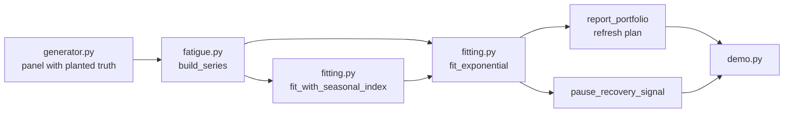

# Architecture

## Context

Ad creatives lose effectiveness as the same audience sees them repeatedly. Teams typically respond with a fixed refresh calendar, which ignores how fast each creative was actually delivered. This project estimates fatigue on the axis where it actually happens, cumulative impressions per reachable user, and turns the result into a per-creative refresh date.

## Components

- `generator.py` builds a daily panel. True response is `base * 2^(-F / half-life)` with F in impressions per reachable user. A shared seasonal cycle and non-constant delivery (flighting, budget changes, a two-week pause) are layered on calendar time.
- `fitting.py` holds the estimator: a weighted nonlinear least-squares fit profiled over the half-life, plus a harmonic seasonal basis fitted by alternating least squares.
- `fatigue.py` builds a series per creative on the chosen axis (`frequency` or `calendar`), applies eligibility rules, and produces refresh reports and the pause diagnostic.
- `demo.py` prints the comparison.

## Key decisions

**Frequency axis instead of calendar axis.** Both models use the same estimator and the same seasonal deconfounder, so the x-axis is the only difference. The calendar model's half-life is in days and depends on delivery rate, which is why it reports different values for two creatives that have identical frequency curves.

**Profiled fit.** The amplitude is conditionally linear, so only the half-life needs searching. The profile is smooth and unimodal on a log grid, so a geometric grid plus golden-section search is robust. Gauss-Newton on both parameters would also work but can diverge without step control.

**Seasonal period as configuration.** The period is supplied rather than estimated, and both models receive the same value, so it cannot favour either axis.

**Refuse instead of guess.** A creative with fewer than 12 observed days or less than one exposure of travel returns "insufficient data".

## Failure modes

- Perfectly constant delivery makes frequency linear in time, so fatigue and seasonal drift are not separable. The fit will still return a number; identification depends on delivery varying.
- The reported "95%" interval is closer to 90% because the curvature standard error is optimistic.
- If real decay is not exponential in frequency, the half-life is a summary of the best exponential approximation.

## Out of scope

- User-level exposure sequences and semi-parametric hazard models.
- Estimating the seasonal period from data.
- Converting refresh timing into currency saved.
- Plotting and report generation.
